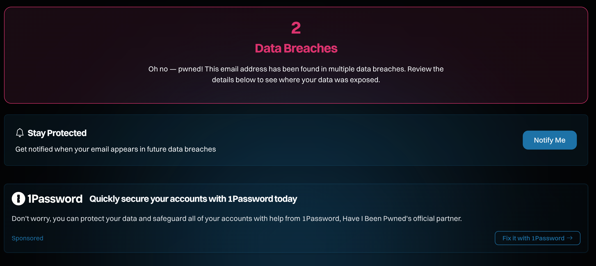
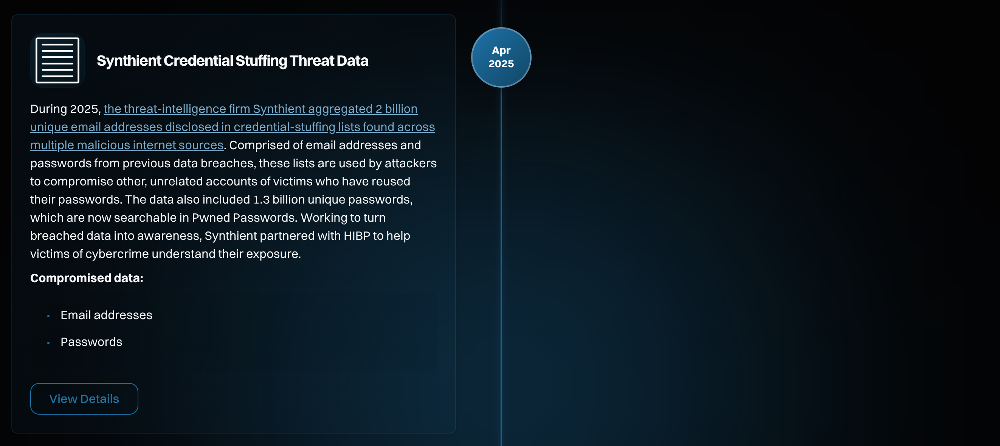
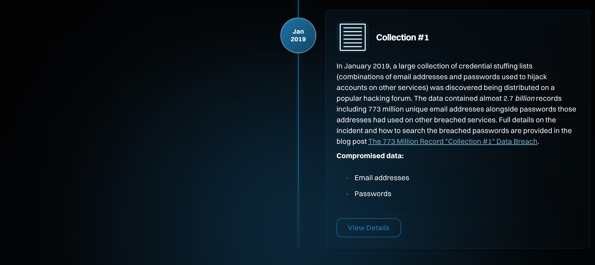

# Le commencement

## Consigne

> À quand peut bien remonter la première perte de données personnelles de Mélanie ? Quelle est la date du premier leak ?
>
> **Format de la preuve :** mm-aaaa - **Exemple :** 08-2020

## Pistes explorées

- Récupération de l'adresse e-mail personnelle de Mélanie (`melanie.lefevre@laposte.net`), trouvée sur son CV en ligne.
- Vérification de cette adresse sur **Have I Been Pwned** pour lister les fuites de données associées.

## Réponse

**01-2019**

## Preuves

