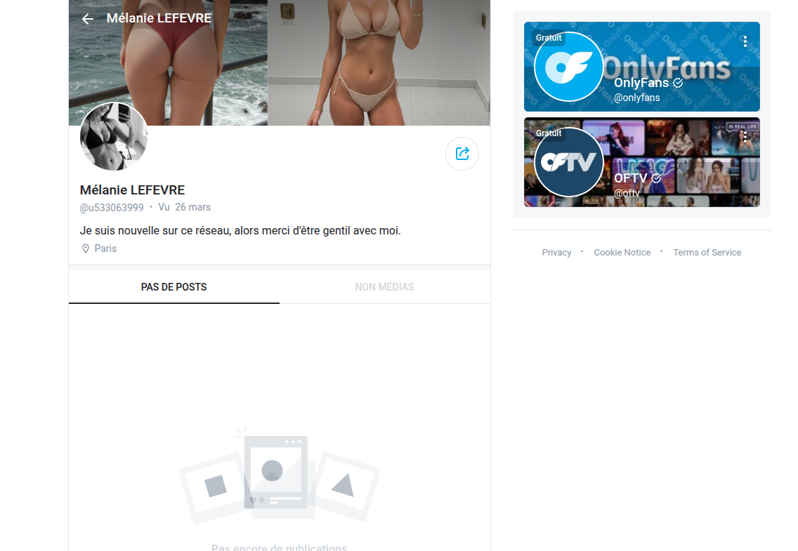

# Le compte de la honte

## Consigne

> Une dernière découverte d'usurpation d'identité met Mélanie à genoux. Elle pensait avoir tout vu. Mais là c'est trop. Son honneur est en jeu. Mélanie est déterminée à trouver les auteurs de cette cabale contre elle. Quel est l'identifiant du compte de la honte ?
>
> **Preuve sensible à la casse : Format :** identifiant **Exemple :** id56350321

## Pistes explorées

- Repérage du profil Facebook usurpé de Mélanie : [facebook.com/profile.php?id=61566117843238](https://www.facebook.com/profile.php?id=61566117843238).
- Sur ce profil, un indice (capture ci-dessous) redirige vers autre chose : pas le compte Facebook lui-même qui est la preuve, mais ce vers quoi il pointe.
- En suivant cet indice, découverte d'un **compte OnlyFans** usurpant également l'identité de Mélanie - la vraie "honte" visée par le challenge.
- Première tentative avec l'identifiant du profil Facebook → incorrect, ce n'est pas le bon compte.
- Récupération de l'identifiant présent dans l'URL du compte OnlyFans.

## Réponse

**u533063999** 

