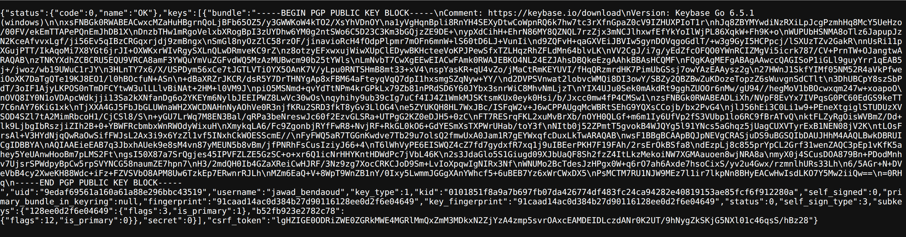

# Le bailleur inconscient

## Consigne

> Samir a reçu ce mail qu'il trouve un peu suspect. Il décide de l'analyser avec vous. Quelle est l'identité de la personne qui se cache derrière cet envoi de mail ?
>
> **Preuve insensible à la casse - Format :** prenom_nom - **Exemple :** edward_snowden

## Pistes explorées

- Première tentative "marie_dubois" (nom trouvé sur le site de l'agence) → incorrecte.
- Le mail provient de `contact@immo-location-pro.fr` → visite du site [immo-location-pro.fr/about.html](https://www.immo-location-pro.fr/about.html), qui liste 3 personnes mais impossible de savoir laquelle sans indice supplémentaire.
- Analyse technique du mail : présence d'une **signature PGP** (`-----BEGIN PGP SIGNATURE-----`, via Keybase), avec la clé `128EE0D2F6E04649`.
- Requête sur l'API Keybase pour identifier le propriétaire de cette clé PGP : `https://keybase.io/_/api/1.0/key/fetch.json?pgp_key_ids=128EE0D2F6E04649`.
- Le JSON retourné révèle le nom complet et l'email associés à la clé.

## Réponse

**jawad_bendaoud** - *(Jawad BENDAOUD, jawad.bendaoud93031@protonmail.com)*
