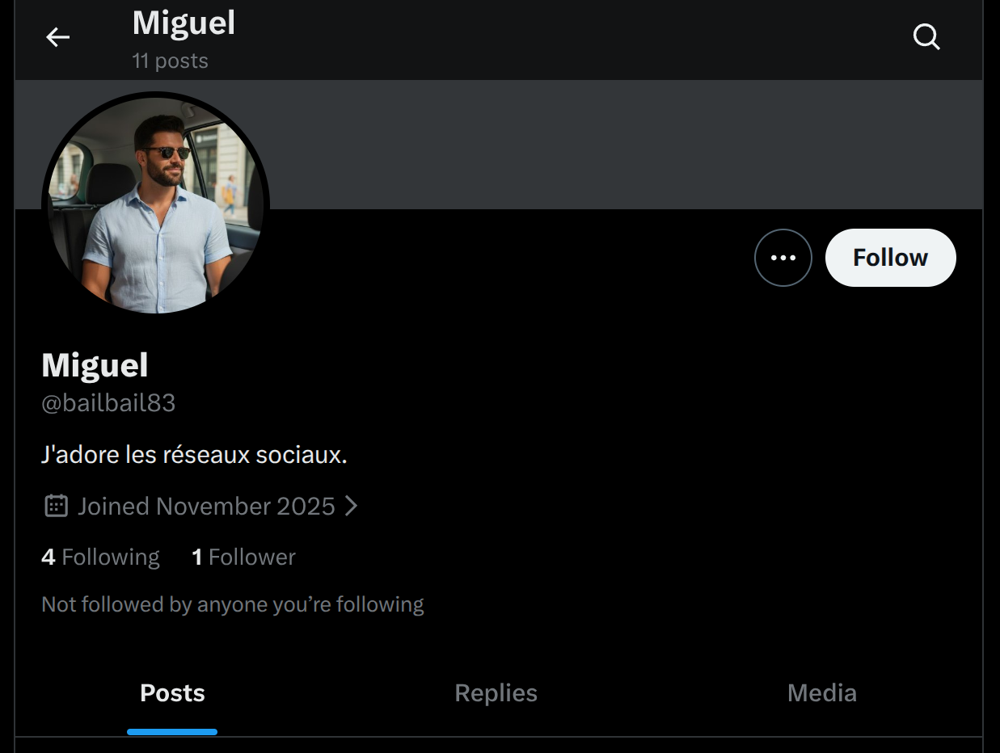

# L'enfer continue

## Consigne

> Mélanie a découvert que son identité est en vente sur internet et que plusieurs escrocs l'utilisent pour commettre des infractions. Comment ont-ils réussi à récupérer autant d'informations et de documents d'identité la concernant. Quel pseudo utilise l'escroc pour approcher ses victimes ?
>
> **Preuve insensible à la casse - Format :** pseudo - **Exemple :** MiouMiou13

## Pistes explorées

- Ce pseudo avait déjà été repéré très tôt dans l'enquête, en marge du salon [sa-vie](../../01-osint-vie-personnelle/sa-vie/) : un compte X ([x.com/bailbail83](https://x.com/bailbail83)) apparaissant dans les réponses au compte de Mélanie, avec un lien vers le site frauduleux `immo-location-pro.fr`.
- Vérification du compte et de ses réponses publiques : [x.com/bailbail83/with_replies](https://x.com/bailbail83/with_replies).

## Réponse

**bailbail83** 
