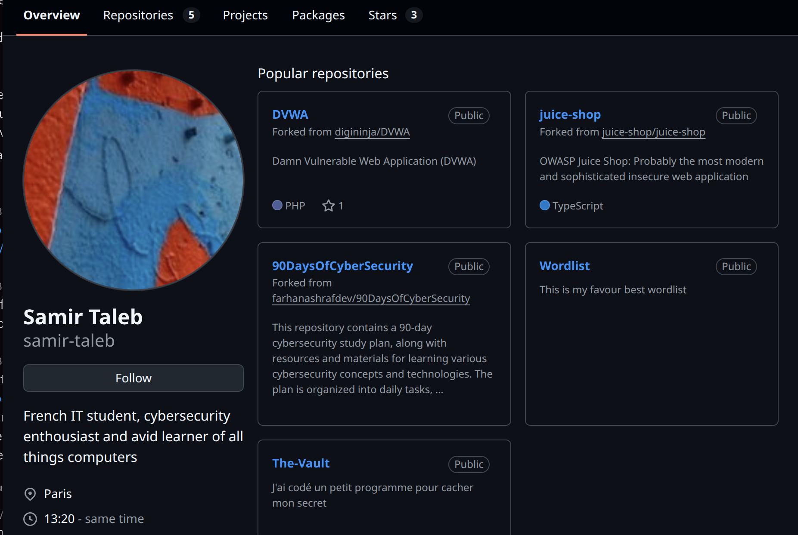

# The Vault

## Consigne

> L'ami de Mélanie utilise un programme sécurisé par un mot de passe. Pouvez-vous retrouver le secret de ce programme ? Quel est le nom du créateur de ce programme ?
>
> **Preuve insensible à la casse - Format :** MOT - **Exemple :** DUPONT

## Pistes explorées

- Découverte du dépôt GitHub public de Samir : [github.com/samir-taleb/The-Vault](https://github.com/samir-taleb/The-Vault/blob/main/LeVault.zip), contenant un script Python **obfusqué avec PyArmor v9**, à exécuter sous Python 3.13.
- Découverte d'un second dépôt du même auteur, [github.com/samir-taleb/Wordlist](https://github.com/samir-taleb/Wordlist), envisagé comme wordlist à faire tourner sur `vault.py` - piste écartée car le challenge est classé "reverse" et "moyen", pas bruteforce.
- Le nom du créateur du programme était en réalité déjà connu : il s'agit de Samir lui-même (identifié dans [son-coloc-samir](../../01-osint-vie-personnelle/son-coloc-samir/)).

## Réponse

**TALEB** 
